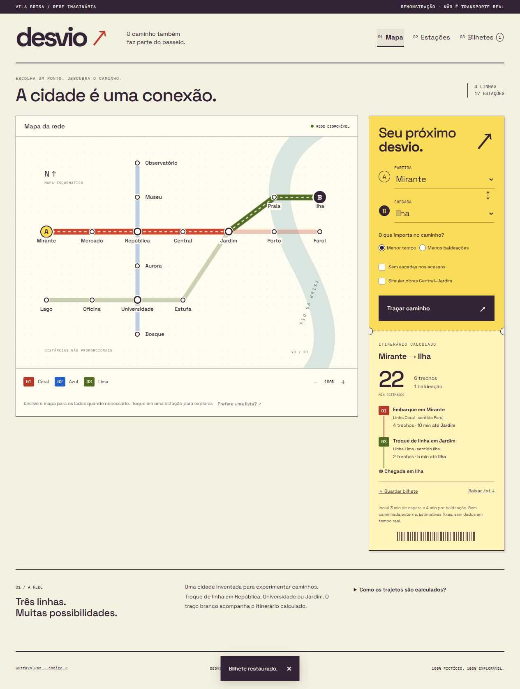

# Validação

- `npm run check`: formatação validada.
- `npm test`: 13 testes aprovados. Inclui todos os pares distintos das 17 estações, com e sem obras, e comparação entre tempo e trocas.
- `npm run build`: TypeScript e build estático aprovados.
- `npm audit`: nenhuma vulnerabilidade conhecida reportada na instalação validada.
- Build minificado: JavaScript aproximadamente 35,3 kB (13,7 kB gzip), CSS 17,7 kB (4,6 kB gzip). Duas fontes WOFF2 locais; sem biblioteca de mapas ou imagens de rede.

## Navegador

Inspeção em desktop de 1280 px, tablet de 768 px e celulares de 390 e 320 px. Documento sem rolagem horizontal acidental; o mapa possui rolagem própria e instrução visível. No tablet, o mapa ocupa toda a largura. O zoom aumenta efetivamente a rede também em telas estreitas.

Confirmados: cálculo e inversão, erro de origem igual ao destino, recusa de acesso sem escadas no Farol, cenário de obras com alternativa por República e Universidade, bilhetes persistidos após reload, remoção, desfazer, coleção vazia, busca sem acentos, busca sem resultado, filtro de linha, detalhes pelo guia e pelo mapa, definição de partida, uso de Enter e Escape e restauração de foco. Download TXT concluído e conteúdo conferido.

Semântica inspecionada na árvore do navegador; nomes dos controles, landmarks e foco visível presentes. Preferência de movimento reduzido implementada em CSS. Nenhuma nota de Lighthouse, teste completo com leitor de tela ou certificação de acessibilidade é alegada. Indisponibilidade de armazenamento possui tratamento no código, sem simulação dessa condição no navegador.

[Captura longa do celular](mobile.jpg)
